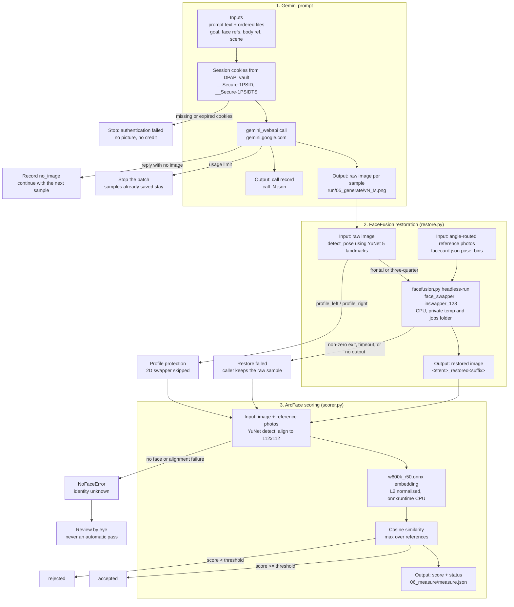

# Architecture

This page describes the local image chain: a prompt sent to the Gemini web app, an optional
FaceFusion face restoration, and ArcFace identity scoring. The Gemini call is the web app through
`gemini_webapi`, authenticated with the browser session cookies in the local DPAPI vault. No billed
Gemini API is used.

The diagram covers the path that produces a judged picture. The staged recipe runner (`facecard.py
run`, `facecard.py gen --goal`) currently judges its samples raw and does not call FaceFusion; the
foreground `gen --prompt` loop and the explicit `restore` / `score` commands do. "Which command does
what" below lists the differences.

## Flow

## Stage 1: Gemini prompt

Entry points: `facecard.py gen --prompt ...` and the staged `runner.py` path (`facecard.py run
<recipe>@vN`, also used by `gen --goal`).

Inputs:

- Prompt text. For a recipe run it is frozen in the recipe lock, and `--dry-run` checks that the
  request bytes match it.
- Ordered reference files: goal image, face references, body reference, inventory references, and
  optionally a scene or layout image and the photo to edit. The Gemini app accepts at most 10 files
  per prompt.
- The Gemini session cookies (`session.py` reads them in process from the DPAPI vault).

Outputs:

- One raw image per returned sample, saved in the run's `05_generate/` folder as `v<N>_<M>.png`
  (the real extension is corrected after download).
- One `call_N.json` per call with outcome, reply text, image ids, image size, credit count, and the
  redacted `gemini_webapi` log.

Failure paths:

- Missing or expired cookies: `AuthError`, the run stops with exit code 1, and no credit is spent.
- Usage limit reached: `UsageLimitExceededError`, the batch stops, and samples already saved stay.
- Reply with no image: recorded as `no_image`, then the next sample continues.
- File upload returns a 5xx: retried up to three times with backoff, then recorded as an error.
- Credit guard refuses the run: exit code 3 before anything is generated.

## Stage 2: FaceFusion restoration

Code: `restore.py`. FaceFusion itself is an external clone in its own Python 3.12 venv
(`paths.facefusion_dir()` and `paths.facefusion_python()`), never bundled with this repo.

Inputs:

- The target image. This is a raw Gemini sample, or a photo supplied to `facecard.py restore`.
- Reference photos chosen by the target's pose bin from `facecard.json` (`pose_bins`), with
  `restore_refs` as the fallback list.
- The FaceFusion clone and its interpreter.

Process:

- `detect_pose` uses YuNet's 5 landmarks to classify the face as frontal, three-quarter left/right,
  or profile left/right.
- `restore_face` calls `facefusion.py headless-run` with `face_swapper` (`inswapper_128`). The
  library default is pixel boost `256x256`; the `restore` CLI parser defaults to `512x512`.
  `face_enhancer` and `expression_restorer` are opt-in, and the default runs use the `box` and
  `occlusion` mask types on the CPU execution provider.
- Swapper weight and expression factor follow the pose bin: weight 0.75 frontal, 0.85
  three-quarter, 1.0 profile only when forced; expression factor 80 frontal, 0 three-quarter and
  profile.
- Each run gets a private temporary folder and job folder, so two restores started at once cannot
  delete each other's files inside the FaceFusion clone.

Outputs:

- The restored image next to the target (`<stem>_restored<suffix>`) or at the path passed to
  `output_path` / `-o`.
- A result dictionary with `success`, `elapsed_sec`, `size_bytes`, the pose decision, and the source
  file names.

Failure paths:

- FaceFusion's Python or `facefusion.py` is missing: `FileNotFoundError`.
- Non-zero exit: `success: False` with the captured stderr or stdout in `error`.
- Timeout (240 seconds by default): `subprocess.TimeoutExpired` propagates.
- Exit 0 but no output file: `success: False` with that message.
- Profile protection: `success: False`, `skipped: True`, `reason: profile_protection`. The 2D
  swapper is not run at profile angles.
- Caller behavior: the `gen --prompt` loop falls back to the raw sample; `facecard.py restore`
  prints the failure and moves to the next target.

## Stage 3: ArcFace scoring

Code: `scorer.py`, with the landmark alignment in `landmarks.py` for the head-crop path.

Inputs:

- The image to score: the restored file when restoration succeeded, otherwise the raw sample.
- Reference photos. `facecard.py restore` and the `gen --prompt` loop compare against the configured
  reference photos; `identity.py` compares against the identity pool.

Process:

- `ArcFaceScorer` detects the largest face with YuNet (score threshold 0.7), estimates an affine
  transform to the canonical ArcFace 112x112 template, and runs `w600k_r50.onnx` through
  onnxruntime on the CPU. The embedding is L2-normalised.
- `embed_head`, used by `identity.py`, first crops a head region around the detected face, upscales
  it so the face is at least 320 pixels wide, and aligns with 2dfan4 68 landmarks. It falls back to
  the YuNet alignment if the landmark fit fails.
- Similarity is cosine similarity. `scorer.score_images` and `cmd_restore` use the maximum score
  over the reference photos. `identity.score_image` uses the mean of the K=3 most similar pool
  photos and excludes near-duplicates of the image being scored.

Outputs:

- Score, pose bin, yaw ratio, Laplacian sharpness, and face box.
- Accepted or rejected status in the run's `06_measure/measure.json` and `run.json`.

Failure paths:

- No face detected, or the alignment transform cannot be estimated: `NoFaceError`.
- Unreadable image: `FileNotFoundError`.
- Missing model files (`face_detection_yunet_2023mar.onnx`, `w600k_r50.onnx`): `FileNotFoundError`
  when `ArcFaceScorer` is constructed.
- A `None` score means identity is unknown. Non-profile candidates are rejected; profile candidates
  are rejected unless the profile rule below passes.

## Which command does what

| Command | Gemini call | FaceFusion restore | ArcFace scoring | Acceptance rule |
|---|---|---|---|---|
| `facecard.py run <recipe>@vN` | `runner.py`, 05_generate | no | yes, in 06_measure | non-profile: max reference cosine >= `identity_threshold` (default 0.60). Profile: >= 0.50 and sharpness >= 200 |
| `facecard.py gen --goal ...` | `runner.py` through an ad-hoc recipe | no | yes, in 06_measure | same as `run` |
| `facecard.py gen --prompt ...` | inline loop in `facecard.py` | yes, unless the raw sample passes the native gate | yes, raw and restored | raw accepted if score >= threshold and sharpness >= 300. Restored accepted if score >= threshold, unless sharpness falls below 0.5x the raw value, in which case the raw score is checked against the hard-coded 0.50 |
| `facecard.py restore <image>` | no | yes | yes | restored score >= threshold, printed as ACCEPTED / REJECTED. No sharpness-loss gate. Profile targets are skipped unless `--force-profile` |
| `facecard.py score <image>` | no | no | yes | prints scores; no accept / reject gate |

`identity.py` uses the mean of the top 3 pool similarities rather than the maximum over the
reference set. That rule is used by `replicate` and by re-measurement, not by the three commands
above.

## Limits

- ArcFace measures a 2D alignment of a face. A bowed, hidden, heavily shaded, or extreme-profile
  face can score low even when it is the right person; the pipeline records the number and leaves
  item 21 of the review checklist to the eye.
- The threshold is calibrated for these model files and this reference set. Changing the onnxruntime
  or OpenCV build can move scores, which is why every staged run records its versions in
  `01_method/env.json`.
- FaceFusion is a pixel-changing face swap. Its output is not pixel-identical to the input, and the
  sharpness and background checks exist because of that.
